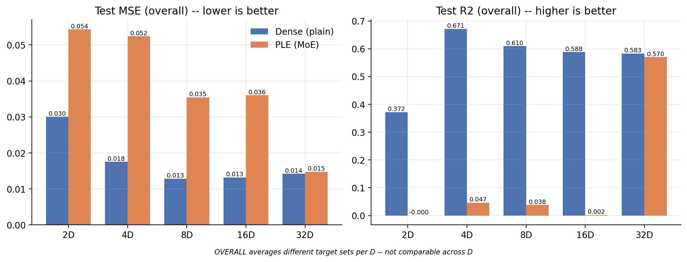
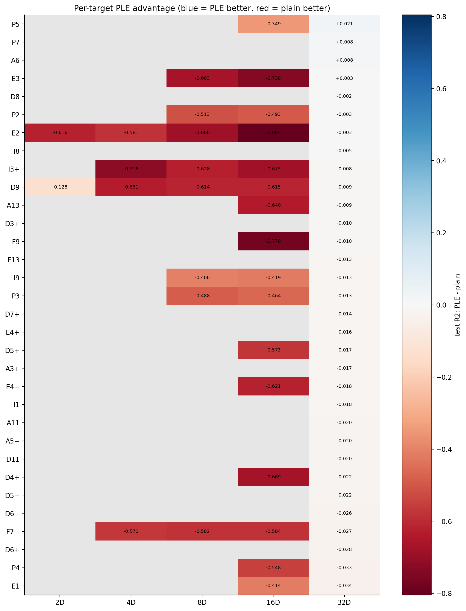
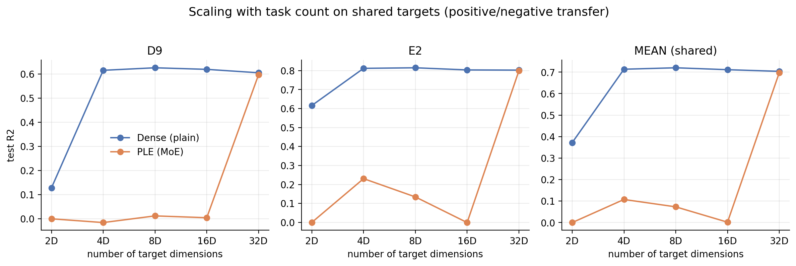

# Measuring Discourse Quality: Task-Count Ablation on Reddit

A controlled comparison of a **dense shared-regression head** and a **Progressive Layered Extraction (PLE / mixture-of-experts)** architecture for predicting discourse-quality dimensions in Reddit political discussions.

This repository contains the two training scripts, the frozen task-count manifest, the cached logs from ten completed runs, and an analysis pipeline that reproduces the report figures and tables. The accompanying write-up is [`53_Dims_10_Experiment_Supervisor_Report.docx`](53_Dims_10_Experiment_Supervisor_Report.docx).

> **Status:** preliminary research code and preliminary results. The archived runs use a single seed and the test metrics are from the final logged checkpoint. See [Limitations](#limitations-and-caveats).

---

## Contents

- [Research question](#research-question)
- [Headline results](#headline-results-preliminary)
- [Experiment design](#experiment-design)
- [Results and artifacts](#results-and-artifacts)
- [Repository layout](#repository-layout)
- [Reproducing the experiments](#reproducing-the-experiments)
- [Checkpoints and large artifacts](#checkpoints-and-large-artifacts)
- [Limitations and caveats](#limitations-and-caveats)
- [Supervisor report](#supervisor-report)

---

## Research question

**How does PLE performance change as the number of predicted discourse-quality dimensions increases, compared with a dense shared-regression baseline?**

The ablation compares the two architectures at five task counts:

| Architecture | Task counts | Runs |
|---|---|---:|
| Dense / Plain | 2, 4, 8, 16, 32 | 5 |
| PLE / MoE | 2, 4, 8, 16, 32 | 5 |

All ten runs use the same backbone, data split, random seed, optimizer, and **unweighted MSE** loss so that the architecture and task-count effects can be compared without a loss-function confound.

## Headline results (preliminary)

Test metrics at the final logged checkpoint (step 29,048), as reported in the supervisor report:

| Tasks | Plain test MSE | Plain test R² | PLE test MSE | PLE test R² | Better |
|---:|---:|---:|---:|---:|---|
| 2 | **0.0300** | **0.3720** | 0.0543 | −0.0001 | Plain |
| 4 | **0.0175** | **0.6714** | 0.0524 | 0.0466 | Plain |
| 8 | **0.0128** | **0.6099** | 0.0354 | 0.0381 | Plain |
| 16 | **0.0132** | **0.5879** | 0.0360 | 0.0020 | Plain |
| 32 | **0.0142** | **0.5827** | 0.0148 | 0.5700 | Plain (narrow) |

Key observations:

- **Plain is the stronger architecture at 2–16 dimensions** on both overall test MSE and R².
- **The gap narrows sharply at 32 dimensions.** Plain still leads, but PLE is close (test R² 0.5700 vs 0.5827).
- **Performance is not monotonic with task count.** Plain peaks at 4D (test R² 0.6714) and is lower at 8D, 16D, and 32D.
- **Per-target analysis is harsher than the overall averages.** PLE wins only 4 of the 32 individual targets at 32D, and none of the targets at 2–16D. The paired per-target results are exploratory and come from one run per setting.
- **PLE's best validation checkpoint is often very early at small/medium task counts** (steps 300–400 at 4D, 8D, and 16D) but much later at 32D (step 25,300). This makes checkpoint selection and evaluation an important part of the next round of experiments.



*Overall test metrics. The “OVERALL” score averages a different target set at each task count, so it is not directly comparable across task counts. Cross-task-count comparisons should use the shared targets (D9 and E2).*



*Per-target difference in test R² (PLE − Plain). Blue means PLE is better; red means Plain is better.*

## Experiment design

### Data

- **Dataset:** [`lanretto/reddit-political-discourse-quality`](https://huggingface.co/datasets/lanretto/reddit-political-discourse-quality)
- **Input text:** `[TITLE] {op_title} [PARENT] {parent_text} [COMMENT] {comment_text}`
- **Maximum sequence length:** 512 tokens
- **Labels:** 53 discourse-quality scores in `[0, 1]`, grouped into 30 **Hostility** dimensions and 23 **Deliberation** dimensions. Dimension names use the dataset's Unicode minus sign (`−`, U+2212), which the scripts normalize explicitly.
- **Split:** the Hugging Face `train` split is divided 80% train / 10% validation / 10% test with seed 42. The validation split is used for checkpoint selection; the test split is evaluated only once at the end.
- **R² reference:** the per-dimension mean of the **training** labels, so R² can be negative when a model is worse than the mean baseline.

### Task-count subsets

The archived runs use the nested subsets below. Each count is balanced 50/50 between Hostility and Deliberation, and the core pair **D9 / E2** is present at every count.

| Tasks | Dimensions |
|---:|---|
| 2 | D9, E2 |
| 4 | D9, F7−, E2, I3+ |
| 8 | P2, P3, D9, F7−, E3, I9, E2, I3+ |
| 16 | P2, P5, P3, F9, D9, P4, E4−, F7−, E3, A13, I9, E1, E2, D4+, D5+, I3+ |
| 32 | P2, P7, P5, P3, A6, F9, D11, D9, A5−, P4, F13, E4−, D5−, D6−, I8, F7−, E3, D8, A13, I9, E4+, E1, D6+, E2, A3+, D4+, D7+, D5+, A11, D3+, I1, I3+ |

**Reproducibility note.** The lists above are the ones used for the archived logs and the report. The checked-in [`dimension_manifest.py`](dimension_manifest.py) documents a later, rank-matched nested manifest for a follow-up rerun. Because both training scripts import that file, rerunning them today selects the newer schedule rather than the archived one. Restore the archived subset lists in the manifest if you need to reproduce the exact runs in this README.

### Models

#### Dense / Plain baseline (`53_plain_dimension_ablation.py`)

The baseline uses the DeBERTa-v3-large `[CLS]` representation and a three-stage regression head:

```text
DeBERTa-v3-large → [CLS] (1024)
                 → Linear 1024→512 → GELU → Dropout(0.1)
                 → Linear 512→256  → GELU → Dropout(0.1)
                 → Linear 256→D    → Sigmoid
```

It is trained with plain unweighted MSE.

#### PLE / MoE (`53_ple_dimension_ablation.py`)

The PLE model uses a two-layer progressive separation design:

1. **Layer 1 — macro routing.** Masked mean pooling of the token embeddings feeds
   - 4 Hostility experts,
   - 4 Deliberation experts, and
   - 4 Shared experts.

   Category gates route each token-level representation through its own experts plus the shared experts. A shared gate routes across all three streams.
2. **Layer 2 — task refinement.** Each target has a task-specific expert, a projection of its category stream, and a projection of the shared stream. A 3-way task gate combines these lanes, followed by a small per-task tower (`256 → 64 → 1 → Sigmoid`).

The PLE script includes an uncertainty-weighted MSE implementation, but the ablation deliberately calls `plain_mse_loss` for both architectures. The `*_std` columns remain in the PLE batches for source compatibility but are **not** used by the loss.

### Training protocol

| Setting | Value |
|---|---|
| Backbone | `microsoft/deberta-v3-large` |
| Optimizer | AdamW |
| Learning rate | `2e-5` |
| Weight decay | `0.01` |
| Scheduler | Cosine annealing over all training steps |
| Batch size | 8 |
| Epochs | 4 |
| Gradient clipping | max norm `1.0` |
| Validation interval | every 100 steps |
| Checkpoint interval | every 200 steps |
| Best-checkpoint criterion | lowest `eval/true_avg_mse_OVERALL` |
| Seed | 42 |
| Device | single CUDA device (`cuda:0` when available) |

Training logs are written to `thesis_cache_{run_name}.csv` and to Weights & Biases. The final test evaluation is appended to the same CSV.

## Results and artifacts

### Best-validation behavior

The best validation step varies substantially by run. These are **validation** metrics, not test metrics:

| Tasks | Plain best step | Plain val R² | PLE best step | PLE val R² |
|---:|---:|---:|---:|---:|
| 2 | 500 | 0.3755 | 3,900 | 0.0001 |
| 4 | 21,800 | 0.6653 | 400 | 0.0508 |
| 8 | 21,700 | 0.6127 | 400 | 0.0391 |
| 16 | 27,800 | 0.6015 | 300 | 0.0019 |
| 32 | 28,500 | 0.5880 | 25,300 | 0.5769 |

PLE reaches its best validation point very early at 2–16D, while at 32D it trains much longer before reaching its best validation loss. This is one reason the report treats the current comparison as preliminary.

### Shared-target scaling

D9 and E2 are present in every subset, so they provide a like-for-like check across task counts:



At 32D, PLE's performance on both shared targets is close to Plain's. At smaller counts, PLE is far behind. This is consistent with the overall pattern, but it does not establish that task count alone caused the change: task composition, optimization, and the architecture's routing behavior may all contribute.

### Analysis outputs

The analysis pipeline writes to [`analysis/analysis_output/`](analysis/analysis_output/):

| File | Description |
|---|---|
| `01_loss_curves.png` | Train/eval/test loss curves for all ten runs |
| `02_eval_r2_curves.png` | Validation R² over training |
| `03_generalization_gap.png` | Eval−train loss gap |
| `04_final_overall_bars.png` | Final test MSE and R² by task count |
| `05_scaling_shared_targets.png` | Scaling on D9 and E2 |
| `06_delta_r2_heatmap.png` | Per-target PLE − Plain test R² |
| `07_largest_dim_per_target.png` | Per-target comparison at the largest task count |
| `08_optimization_health.png` | Gradient norms and learning-rate schedules |
| `09_convergence_speed.png` | Steps until eval loss is within 5% of its minimum |
| `summary_overall.csv` | Overall metrics and checkpoint metadata per run |
| `per_target_final.csv` | Per-target test/eval metrics for every run |
| `paired_stats.csv` | Per-task-count PLE − Plain test R² summary and Wilcoxon tests |
| `scaling_shared_targets.csv` | Test R² for D9 and E2 at every task count |

The analysis selects the **best validation checkpoint** for eval metrics. Because the training scripts log test metrics only at the end of training, the `test_*` columns correspond to the final logged checkpoint. This convention is stated explicitly in the supervisor report.

## Repository layout

```text
.
├── 53_plain_dimension_ablation.py     # dense shared-regression training script
├── 53_ple_dimension_ablation.py       # PLE / MoE training script
├── dimension_manifest.py              # nested task-count subsets
├── thesis_cache_{plain,ple}_{2,4,8,16,32}D.csv
│                                      # raw per-run training logs
├── analysis/
│   ├── ple_vs_plain_analysis.py       # tables + figures
│   ├── thesis_cache_*.csv             # frozen copies used for the analysis
│   └── analysis_output/               # generated PNGs and CSVs
├── 53_Dims_10_Experiment_Supervisor_Report.docx
├── requirements.txt                   # full package freeze from the training host
└── requirements-min.txt               # portable minimal environment
```

`checkpoints_dimension_ablation/` is intentionally **not** committed. It contains large per-step and best-model weight files from the runs. See [Checkpoints and large artifacts](#checkpoints-and-large-artifacts).

## Reproducing the experiments

### 1. Environment

Python 3.10+ and a CUDA-capable GPU are recommended. A portable minimal environment:

```bash
python -m venv .venv
source .venv/bin/activate
pip install -r requirements-min.txt
```

`requirements.txt` is the complete `pip freeze` from the original training host. Some entries contain host-specific `file:///` build paths and will not install elsewhere; use `requirements-min.txt` for a fresh environment.

### 2. Log in to Hugging Face and Weights & Biases

The dataset is public, but downloading the DeBERTa-v3-large backbone may require a Hugging Face login. The training scripts log to W&B:

```bash
huggingface-cli login
export WANDB_API_KEY="..."
```

Change the hard-coded `wandb.init(entity=..., project=...)` values in both scripts if you want the runs in your own workspace.

### 3. Set the checkpoint directory

Both scripts write checkpoints to a host-specific path:

```python
CHECKPOINT_DIR = f"/data/nfs/larry/runs_time/{run_name}"
```

Change this to a writable location on your machine before training.

### 4. Train one or more runs

```bash
python 53_plain_dimension_ablation.py --num_dimensions 8
python 53_ple_dimension_ablation.py --num_dimensions 8
```

Supported task counts are `2`, `4`, `8`, `16`, and `32`. Each run writes:

- `thesis_cache_{run_name}.csv` in the working directory;
- `best_model.pt` and `ckpt_step*.pt` under `CHECKPOINT_DIR`;
- metrics, per-target losses, and figure grids to W&B.

The scripts include a `SMOKE_TEST` flag. Set `SMOKE_TEST = True` to stop after one fully logged, evaluated, and checkpointed step.

> **Manifest caveat:** see the reproducibility note in [Task-count subsets](#task-count-subsets). The checked-in manifest defines a newer rerun schedule and differs from the archived run subsets.

### 5. Regenerate the analysis

```bash
cd analysis
python ple_vs_plain_analysis.py
```

The script expects the ten `thesis_cache_{plain,ple}_{2,4,8,16,32}D.csv` files in the current directory and writes `analysis_output/`. Install `scipy` if you want the Wilcoxon p-values in `paired_stats.csv`.

## Checkpoints and large artifacts

The checkpoint directory is excluded because it is far too large for GitHub and is not needed to reproduce the analysis. The training scripts can regenerate it. If you need the original weights, retrieve them from the training host or the W&B run artifacts.

The repository also does **not** contain the raw Reddit text or the full Hugging Face dataset. Only aggregate/per-target CSV logs, figures, and the report are included.

## Limitations and caveats

- **Single seed.** Each setting was run once with seed 42. Run-to-run variance has not been estimated, so small gaps should not be over-interpreted.
- **Final-checkpoint test metrics.** The training scripts evaluate the test split only at the end. The reported test metrics therefore come from the final logged checkpoint, not necessarily the best-validation checkpoint.
- **Best-checkpoint verification.** The CSVs identify the best validation step, but the saved `best_model.pt` weights should be verified against those steps before making final claims.
- **Nested task sets.** Task count changes together with task composition. The ablation cannot isolate “more tasks” from “these particular tasks.”
- **Architecture confounds.** Plain uses the `[CLS]` representation, while PLE uses masked mean pooling. The comparison therefore includes representation-pooling differences in addition to routing and expert structure.
- **No multi-seed confidence intervals.** The Wilcoxon tests in `paired_stats.csv` are per-target paired tests from a single run per setting. They are useful for exploration, not for a definitive significance claim about architecture performance.
- **Evaluation-level averages are not comparable across task counts.** `OVERALL` averages a different target set at each count. Use D9/E2 or the per-target CSV for cross-count comparisons.
- **Hard-coded experiment infrastructure.** W&B entity/project and checkpoint paths are specific to the original environment.

## Supervisor report

The full preliminary write-up, including the ten-run comparison, best-validation table, matched-dimension analysis, and next steps:

**[53_Dims_10_Experiment_Supervisor_Report.docx](53_Dims_10_Experiment_Supervisor_Report.docx)**

The report's next steps are the natural continuation of this repository:

1. Verify that `best_model.pt` corresponds to the minimum validation overall MSE for each run.
2. Load each selected checkpoint and evaluate it on the same held-out test split.
3. Replace or supplement the final-checkpoint table with selected-checkpoint test results.
4. Inspect validation learning curves to understand the early PLE best steps and later training behavior.
5. If resources permit, repeat the experiments with additional seeds to estimate variability.

---

**Author:** [@niyimoluga](https://github.com/niyimoluga) · **Backbone:** [microsoft/deberta-v3-large](https://huggingface.co/microsoft/deberta-v3-large) · **Dataset:** [lanretto/reddit-political-discourse-quality](https://huggingface.co/datasets/lanretto/reddit-political-discourse-quality)
